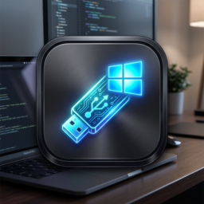

<div align="center">



# ⚡ WinDisk Maker
**Pembuat USB Bootable Windows Profesional untuk macOS (Intel & Apple Silicon)**  
*Modern, Fast, Safe, and NVMe SSD Ready with Intel RST VMD Patch*

[](LICENSE)
[](https://www.rust-lang.org/)
[](https://apple.com)
[](CONTRIBUTING.md)

[**Fitur Utama**](#-fitur-utama) • [**Unduh & Pasang**](#-unduh--instalasi) • [**Cara Penggunaan**](#-cara-penggunaan) • [**Build dari Source**](#-build-dari-source) • [**Kontribusi**](#-kontribusi)

</div>

---

## 📖 Tentang WinDisk Maker

**WinDisk Maker** adalah aplikasi desktop native untuk macOS yang dirancang khusus untuk membuat flashdisk bootable Windows 10, Windows 11, atau Windows Server secara cepat, aman, dan mudah.

Aplikasi ini menyelesaikan masalah klasik pengguna Mac yang ingin membuat installer Windows:
1. **Pemisahan `install.wim` Otomatis**: Partisi FAT32 memiliki batasan ukuran file maksimal 4GB, sedangkan berkas instalasi Windows modern (`install.wim`) umumnya berukuran 5–6GB. WinDisk Maker secara otomatis memecah berkas tersebut ke format `.swm` agar installer dapat di-boot via UEFI di PC mana pun.
2. **Patch Driver Intel VMD / NVMe SSD Terintegrasi**: Mengatasi masalah *"We couldn't find any drives"* pada laptop Intel Generasi ke-11/12/13/14 dengan menyuntikkan driver `iaStorVD` ke `$WinPEDriver$` dan direktori driver USB.
3. **Deteksi Otomatis Anti-Salah Pilih**: Menghindari bahaya memformat disk sistem macOS (`disk0`/`disk1`) atau disk image iOS simulator. Hanya flashdisk USB fisik nyata yang dapat dipilih, lengkap dengan merk dan label volume Finder.

---

## ✨ Fitur Utama

- 🔍 **Deteksi USB Real-Time & Cerdas**:
  - Memantau penancapan dan pencabutan flashdisk USB secara otomatis di background tanpa membebani antarmuka (Zero UI-Lag).
  - Menampilkan merk flashdisk lengkap (SanDisk, Kingston, Kioxia, dll.), label drive di Finder, kapasitas nyata, dan lokasi device node (`/dev/diskX`).
- 🛡️ **Proteksi Keamanan Berlapis**:
  - Disk internal Mac (`disk0`, `disk1`) dan virtual disk image disaring ketat dan diblokir dari proses format.
  - Dialog konfirmasi interaktif sebelum format dilakukan.
- ⚡ **Driver NVMe / Intel VMD Siap Pakai**:
  - Menyertakan paket driver resmi: `iaStorVD.inf`, `iaStorVD.sys`, `iaStorVD.cat`, `RstMwService.exe`, dan `RstMwEventLogMsg.dll`.
  - Disalin ke `$WinPEDriver$` agar otomatis dimuat (*auto-load*) oleh Windows Setup saat booting.
- ✂️ **Pemecahan WIM Otomatis (FAT32 UEFI Compatible)**:
  - Menggunakan utilitas `wimlib-imagex` untuk membagi `install.wim` menjadi bagian-bagian di bawah 3.8GB, menjamin kompatibilitas UEFI booting tanpa perlu format NTFS pihak ketiga.
- 📟 **Konsol Streaming Langsung**:
  - Log keluaran dari `rsync`, pemformatan partisi, dan `wimlib` mengalir secara live baris demi baris (*real-time streaming*) di konsol log mini.
- 🎨 **Antarmuka Premium**:
  - Dibuat dengan [egui](https://github.com/emilk/egui) & [eframe](https://github.com/emilk/egui/tree/master/crates/eframe) dengan palet warna dark mode modern dan responsif.

---

## 📥 Unduh & Instalasi

### Menggunakan Aplikasi Jadi (.app)
1. Unduh rilis terbaru `WinDisk Maker.app` dari [Halaman Releases](https://github.com/lerryleer33/WinDiskMaker/releases).
2. Geser atau salin `WinDisk Maker.app` ke folder `/Applications` di Mac Anda.
3. Buka aplikasi dan siap digunakan!

### Prasyarat Sistem
Aplikasi memerlukan utilitas `wimlib` untuk memecah berkas `install.wim` yang berukuran di atas 4GB. Anda dapat memasangnya via [Homebrew](https://brew.sh):
```bash
brew install wimlib
```

---

## 🚀 Cara Penggunaan

1. **Jalankan Aplikasi**: Buka `WinDisk Maker.app`.
2. **Pilih File ISO Windows**: Klik tombol **"📂 Pilih Berkas ISO Windows..."** dan cari berkas `.iso` Windows 10/11 Anda.
3. **Pilih Drive USB Tujuan**: Tancapkan flashdisk USB Anda (minimal 8GB). Aplikasi akan mendeteksinya secara otomatis dan memilihnya di dropdown.
4. **Periksa Opsi Kompatibilitas**:
   - Skema Partisi: **MBR FAT32** (Kompatibel luas untuk UEFI & Legacy BIOS).
   - Opsi: **☑️ Pasang Patch Driver NVMe / Intel VMD (iaStorVD)** (Direkomendasikan tetap aktif).
5. **Mulai Pembuatan**: Klik **"🚀 MULAI PEMBUATAN USB BOOTABLE"** dan konfirmasi pada dialog pop-up.
6. Tunggu hingga proses selesai (~5–10 menit tergantung kecepatan flashdisk). Flashdisk siap digunakan untuk menginstal Windows!

---

## 🛠️ Build dari Source

Bagi pengembang yang ingin mengompilasi sendiri dari kode sumber:

### 1. Clone Repositori
```bash
git clone https://github.com/lerryleer33/WinDiskMaker.git
cd WinDiskMaker
```

### 2. Jalankan Mode Pengembangan
Pastikan Anda sudah menginstal Rust ([rustup.rs](https://rustup.rs)):
```bash
cargo run
```

### 3. Bundel Menjadi Aplikasi macOS (.app)
Kami telah menyediakan skrip otomatis untuk menghasilkan bundle `.app`:
```bash
./build_app.sh
```
Aplikasi yang sudah jadi akan tersedia di:
`./WinDisk Maker.app`

---

## 🤝 Kontribusi

Kontribusi dari komunitas sangat diterima! Baik berupa pelaporan bug, saran fitur baru, perbaikan dokumentasi, atau pengiriman Pull Request.

Silakan baca [PANDUAN KONTRIBUSI (CONTRIBUTING.md)](CONTRIBUTING.md) untuk detail alur pengembangan.

---

## 📄 Lisensi

Proyek ini didistribusikan di bawah lisensi **MIT License**. Lihat berkas [LICENSE](LICENSE) untuk informasi lebih lanjut.

---

<div align="center">
Dibuat dengan ❤️ untuk komunitas macOS dan PC.
</div>
